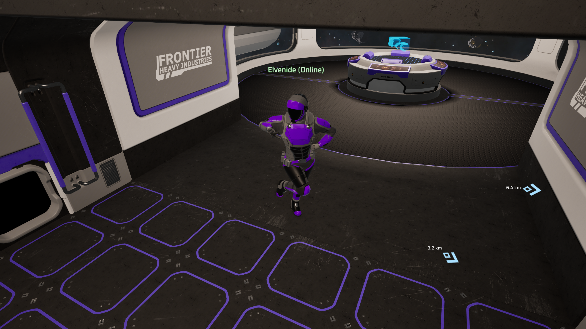

# Cinematic Freecam

Toggle built-in **Spectator Mode** and **Hide HUD** together with a single keypress for clean screenshots and cinematic camera movement.

*Cinematic Freecam active inside a space station with the HUD hidden and free-flying Spectator Mode enabled.*

## Usage

- Press **`C`** (default) at any time in-game to enable both Spectator Mode and Hide HUD.
- Press **`C`** again to exit Spectator Mode and restore the HUD.

## Configuration

- **In-Game**: Open **Settings → Controls** and look for **Cinematic Freecam** to rebind the key.
- **Config File**: Stored in `Eqol/config.json` under `"CinematicFreecamKey"`.
