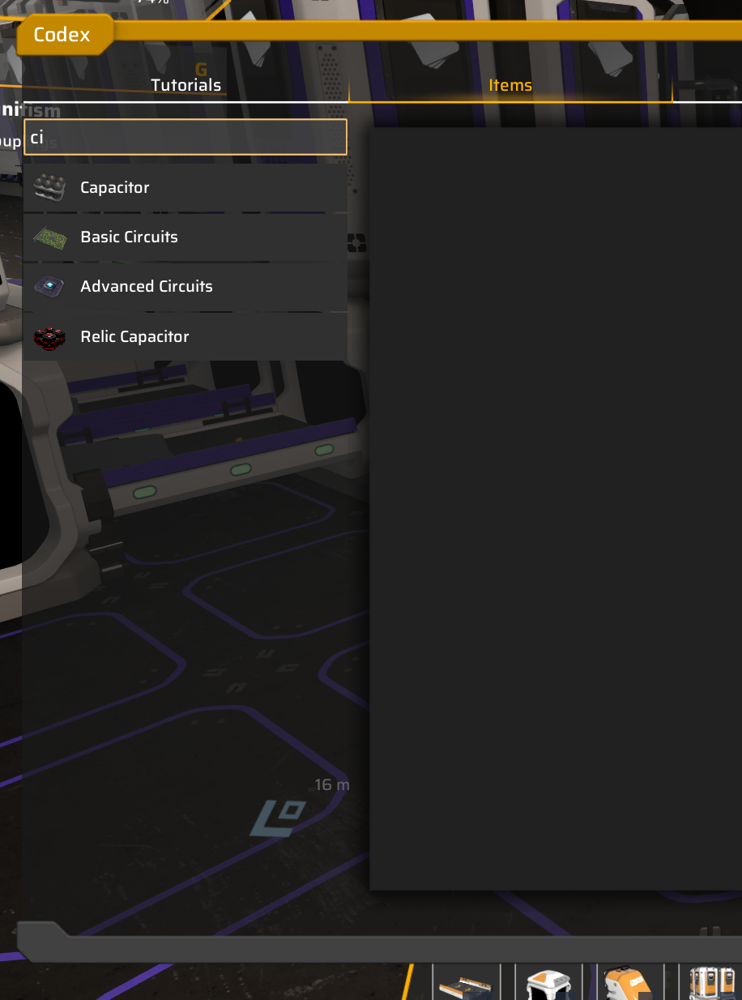

# Codex / Help Menu Search Bar

Adds a live search bar to the Help / Codex menu (`K`) so you can quickly find items, machines, mechanics, and entries in any tab.

*Live Codex search bar filtering the Items tab in real time for entries matching "ci".*

## Features

- Injects a native-styled search input (`WBP_TextInput`) into the Codex (`WBP_CodexContent_C`) entry list.
- Filters entries in real time as you type (case-insensitive substring match against entry display names).
- Automatically clears the search filter when switching Codex tabs so every tab opens unfiltered.
