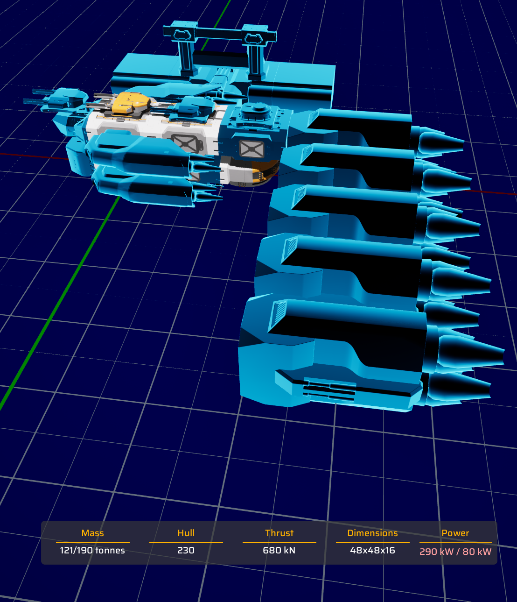
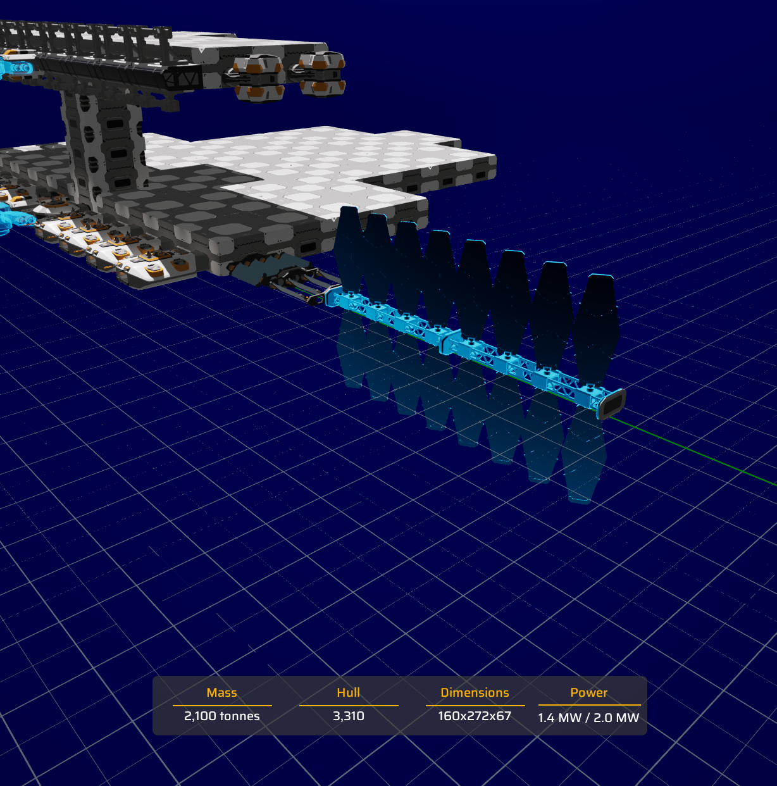

# Designer Power Stats

See total power generation and power consumption directly inside the **Ship Designer** and **Station Designer**.

## Features

- Adds a **Power** column alongside existing stats (such as Mass, Hull, and Dimensions) in the designers, displaying `[consumption] / [production]`.
- Automatically updates as you add, remove, or modify power-generating blocks (solar panels, reactors) and power-consuming blocks/machines in your blueprint.
- Highlights the **Power** value in red when consumption exceeds generation so you can spot power deficits before finalizing a build.

## Examples

*Ship Designer HUD displaying the Power column (`290 kW / 80 kW`) highlighted in red when consumption exceeds generation.*

*Station Designer HUD displaying the Power column (`1.4 MW / 2.0 MW`) alongside Mass, Hull, and Dimensions.*
