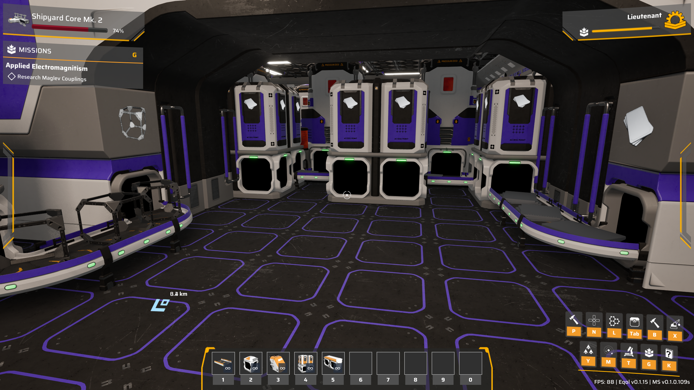

# Item Elevator Port Icons

See what items are currently routed through nearby item elevator ports without opening each port.

*World-space item icons displayed above populated item elevator ports on the station floor.*

## Features

- Displays a 3D world-space item icon (`WBP_Item` via `WidgetComponent`) directly on the blank gray panel above each populated conveyor port on `AElevator` / `UElevatorObject.ItemColumns`.
- Projects the matching port icon across **every stacked elevator floor** in the shaft (both above and below the feeder floor).
- Automatically culls icons beyond **`30m`** from the viewing camera for smooth performance.
