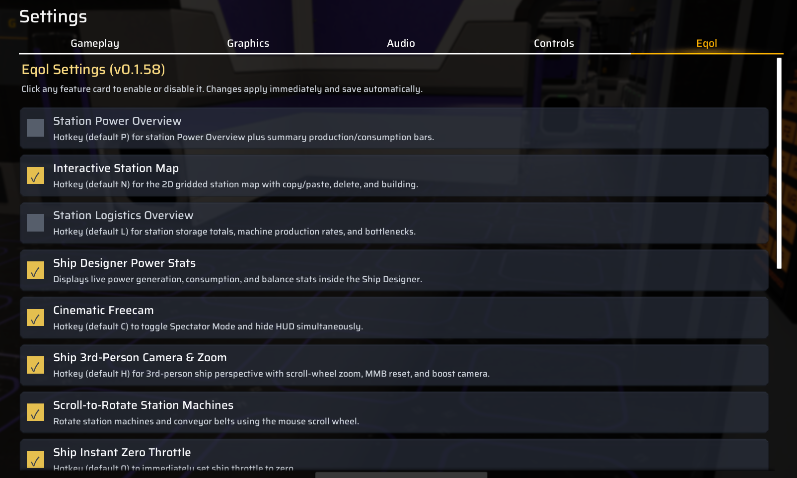

# In-Game Eqol Settings Tab

Eqol adds a native **Eqol** tab directly inside Main Sequence's **Settings** menu, letting you enable or disable individual Eqol features on the fly without editing files or restarting the game.

*The native Eqol tab inside the Settings menu showing per-feature enable/disable cards.*

## How to Open

1. Press **Esc** (or open **Settings** from the Main Menu).
2. Click **Settings**.
3. Click the **Eqol** tab in the top Settings tab bar.

## Features

- **Per-Feature Enable / Disable Toggles**: Every toggleable Eqol feature is listed in a clean card layout matching the game's native Settings UI, complete with a short description of what each feature does.
- **Instant Live Application**: Toggling a feature takes effect immediately -- hiding/restoring injected UI, bars, badges, overlays, or hotkeys without requiring a reload.
- **Automatic Persistence**: Toggle states are saved automatically to `Eqol\config.json` and preserved across updates.
- **Keybind Integration**: Configurable Eqol hotkeys remain in **Settings → Controls** alongside vanilla keybinds.

## Notes

- **Splitter & Belt Balancer Walk-Through** is deliberately not toggleable in this menu to avoid players getting stuck inside them.
- This feature is 100% client-side and save-safe.
