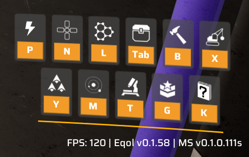

# HUD Version & FPS Bar

Enhances *Main Sequence*'s existing bottom-right version label in-place to show your live FPS alongside both the Eqol and *Main Sequence* version numbers.


*Bottom-right HUD showing the live FPS, Eqol version, and Main Sequence version below the station menu keybind indicators.*

## Format

```text
FPS: <fps> | Eqol v<eqol version> | MS v<main sequence version>
```

## Details

- Edits the vanilla bottom-right version `TextBlock` in-place (preserving its exact font, size, color, and styling) and enables auto-sizing so the text never clips.
- Updates FPS twice per second (`0.5s` window) with minimal overhead.
