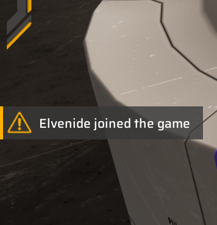

# Player Join & Leave Alerts

Receive native in-game alerts whenever players (including the host) join or leave the session.

*Native in-game alert banner notifying when a player joins the session.*

## Features

- Uses Main Sequence's built-in `WBP_PlayerAlerts` notification banner (the same alert feed used for station low-power warnings and relic fleet alerts).
- Notifies when the host or any remote player connects or disconnects.
