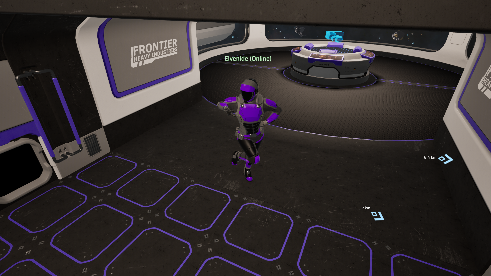

# Player Nametags (Online / Offline Status)

Displays floating nametags above all players -- including yourself and offline player bodies -- with a live status indicator.

*Floating 3D nametag displaying a player's name and green `(Online)` status above their character.*

## Features

- Renders 3D nametags directly above each player's head, rotating cleanly to face the viewing camera.
- Shows each player's nickname and **Green (`Online`)** / **Red (`Offline`)** status.
- Uses camera-relative visibility and a 25 m max viewing distance, so you can see your own and other players' nametags in 3rd-person, Cinematic Freecam, or Spectator Mode without clutter from across the station.
