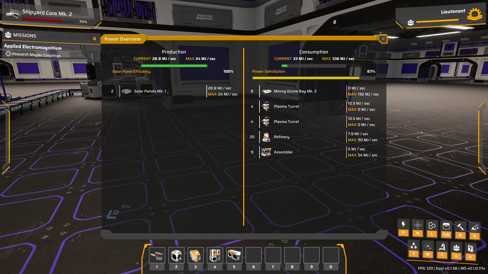

# Power Overview Enhancements

Quickly check your station's power grid from anywhere inside a space station and see power efficiency at a glance.

*Power Overview opened via hotkey showing Production and Consumption summary bars and the color-coded Power Satisfaction readout.*

## Features

- **Global Power Overview Hotkey (Default: `P`)**
  - Press `P` while on foot in a space station to open the Power Overview window immediately -- no need to walk up to a machine first.
  - Press `P` again while the Power Overview is open to close it.
  - A **Power (`P`)** keybind indicator appears in the top-right HUD while on foot in a space station and updates automatically if you rebind the key.
- **Summary Header Progress Bars**
  - **Production (`Current / Max`)**: Static green bar showing how much of your maximum power generation capacity is currently being produced.
  - **Consumption (`Current / Max`)**: Static green bar showing how much of your maximum power demand is currently being drawn.
  - **Power Satisfaction (`Production / Consumption`)**: Dynamic status bar with percentage readout that shifts color based on grid health:
    - **Green**: 100%+ satisfaction (full power)
    - **Amber**: 50%–99% satisfaction (brownout)
    - **Red**: Under 50% satisfaction (severe power deficit)

## Configuration

- **In-Game**: Open **Settings → Controls** and look for **Power Overview** to rebind the key, revert to default (`P`), or clear the binding.
- **Config File**: Stored in `Eqol/config.json` under `"PowerOverviewKey"`.
