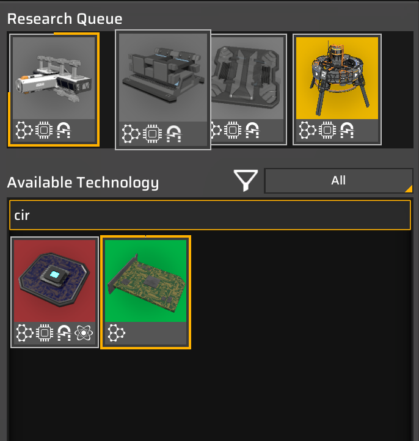

# Research Tree Search & Queue Drag-and-Drop

Adds a live search box to the Research / Technology screen and lets you reorder queued research items via drag-and-drop.

*Research screen showing a queued technology being dragged to reorder alongside the live search filter matching "cir".*

## Features

- **Live Research Search**:
  - Injects a native-styled search bar into the Research screen (`WBP_TechTree_C`) to filter technologies by display name, description, or unlocked items.
  - Preserves the game's active category/status filter while narrowing results to matching technologies.
- **Queue Drag-and-Drop Reordering**:
  - Drag queued technologies in the research queue list to reorder them cleanly.
  - Reorders via the game's native `QueueResearch` / `UnqueueResearch` RPCs so changes remain deterministic and multiplayer-safe.
  - Automatically aborts a reorder if the queue changed mid-drag (for example, if a technology finished researching while dragging).
