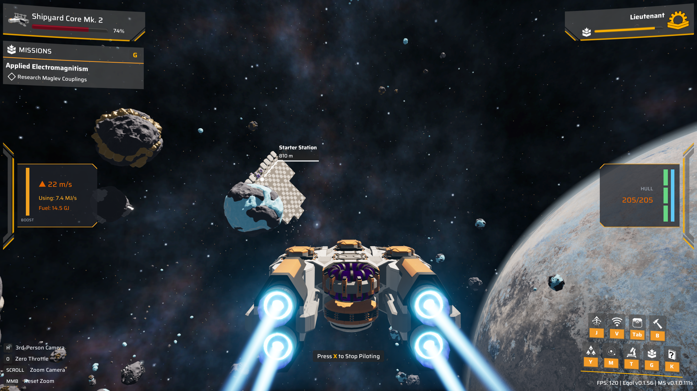

# Ship 3rd-Person Perspective, Scroll Zoom & Telemetry Wings

Switch between 1st-person and dynamically scaled 3rd-person camera views while piloting any spaceship, complete with reactive boost camera and symmetrical HUD telemetry wings.

*3rd-person ship perspective with symmetrical speed/fuel and hull/shield telemetry wings and the contextual bottom-left keybind legend.*

## Usage

- Press **`H`** (default) while piloting a ship to toggle between 1st-person and 3rd-person perspective.
- **Scroll Zoom**: While in 3rd-person view, scroll the **Mouse Wheel** to zoom between **`1.0×` and `7.0×`** (`0.25×` per step, default **`3.0×`**), dynamically scaled to fit your custom ship's bounding radius.
- **Reset Zoom**: Press **Middle Mouse Button (`MMB`)** while in 3rd-person to snap back to the default `3.0×` zoom distance.
- **Reactive Boost Camera**: Boosting (`Spacebar`) smoothly pulls the camera back (`+18%`) and widens FOV (`+12°`) based on your ship's live boosting state.
- **3rd-Person Telemetry Wings**: Symmetrical chamfered amber-bordered HUD cards appear on the left and right center of the screen while in 3rd-person:
  - **Left Wing**: Vertical **Boost** charge bar, live **Speed** readout with direction indicator (`▲` forward / `▼` reverse / `—` idle), live fuel burn rate (`Using:`), and continuous total fuel remaining (`Fuel:`).
  - **Right Wing**: **Hull** integrity readout with a 3-segment color-coded hull bar (green / orange / red) and a smooth vertical **Shield** progress bar.
- **Contextual Ship Keybind Legend**: A compact bottom-left keybind legend appears while piloting, showing your active `3rd-Person Camera` and `Zero Throttle` bindings (plus `SCROLL` and `MMB` hints while in 3rd-person).

## Configuration

- **In-Game Keybind**: Open **Settings → Controls** and look for **Ship Camera Perspective** to rebind the toggle key.
- **Enable / Disable**: Toggle live in **Settings → Eqol**.
- **Config File**: Stored in `Eqol/config.json` under `"ShipPerspectiveKey"`.
