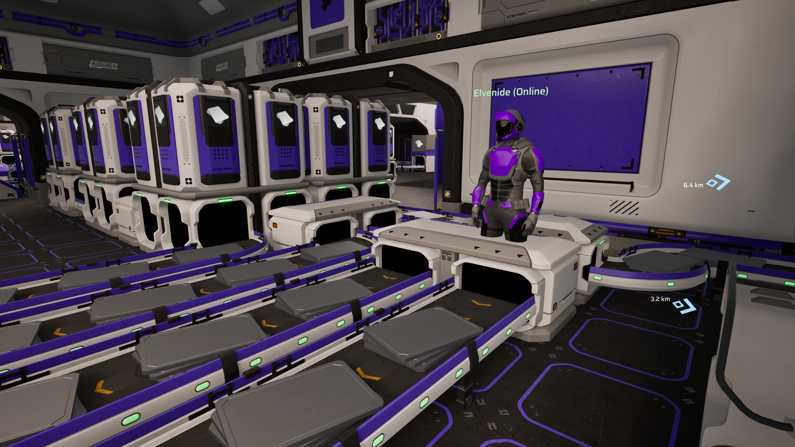

# Splitter, Balancer & Underground Belt Tweaks

Makes factory floors easier to navigate by letting you walk directly over Splitters and Belt Balancers, and compacts Splitters, Belt Balancers, and Underground Belts to 2/3 height.

*Player walking directly across a 2/3-height Belt Balancer on a factory conveyor line.*

## Features

- **Walk-Through Splitters & Belt Balancers (Single-Player Only)**:
  - Disables player collision on Splitters and Belt Balancers so you can walk across logistics lines smoothly -- matching vanilla conveyor belts -- while keeping building bounds and placement rules intact.
  - Always active in single-player and **automatically disabled in multiplayer** (both host and client) to prevent movement desync.
- **Compact 2/3 Height (Toggleable)**:
  - Scales Splitter, Belt Balancer, and Underground Belt meshes vertically to **2/3 height**, anchored cleanly to the floor.
  - Works in both single-player and multiplayer, and can be toggled on/off live in **Settings → Eqol**.
- **Instant & Automatic**:
  - Applies automatically to existing machines on map load and to newly built machines immediately upon construction.
